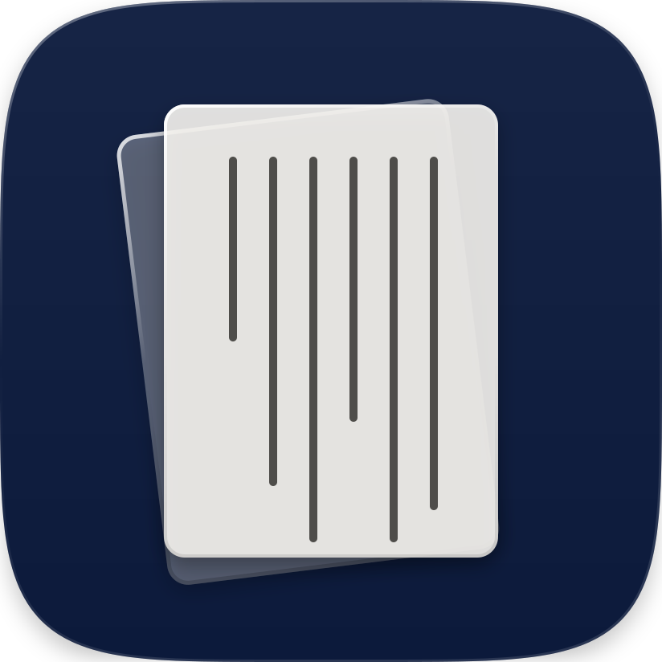

<div align="center">



# Mori

Astro 博客主题

[](https://github.com/Musenxi/Astro-Theme-Mori)
[](LICENSE)
[](https://astro.build)
[](https://tailwindcss.com)
[](https://www.typescriptlang.org)
[](https://maplibre.org)
[](https://nodejs.org)
[](https://pnpm.io)

</div>

编辑器是 [Mori Studio](https://github.com/Musenxi/Mori-Studio)，自建评论是 [Mori-Comment](https://github.com/Musenxi/Mori-Comment)。

## 特点

- **排版**：中文用东观体，西文和数字用 EB Garamond；首页有引文版、封面版、列表三种版式，首页和归档都可以横排或竖排。
- **三种读法**：每篇文章都能开竖向 / 横向 / 混合读法，读者自己切换；横向长卷里的图文可以自由摆放，带版心、出血和章节刻度。
- **地图**：正文里标出地点，封面画出路线，读到哪里左下角的小地图就飞到哪里，点开是整篇的大地图；`/map/` 汇总所有带位置的照片和行程。
- **看大图**：右侧信息栏显示 EXIF、直方图和拍摄位置，可以前后翻图。
- **评论**：自建评论支持选中正文发表“引用评论”，也能接 Giscus、Waline、Twikoo、Artalk、Disqus。
- **阅读量、点赞、在线人数**：记在自建评论服务里，显示在文章页头和右下角，Studio 仪表盘里实时更新。
- **其他**：站内搜索、RSS、站点地图、昼夜模式、剧透、代码高亮、KaTeX 公式。

## 开始使用

1. 在 GitHub 上点 **Use this template**（或 Fork），建一个自己的仓库，克隆到本机。也可以用 Studio 直接新建：`node <Mori-Studio>/bin/mori-studio.mjs create 新文件夹`。
2. 安装并运行（需要 Node.js 22.12 或更新、pnpm）：

   ```bash
   pnpm install
   pnpm dev        # http://localhost:4321
   ```

3. 改 `mori.config.ts`：只写要改的项，其余用默认值，每一项的说明在 `src/config.ts`。
4. 在 `src/content/` 里写文章，图片放 `src/assets/`。可以直接编辑 JSON（格式见[写作指南](docs/写作指南.md)），也可以用 Studio。
5. 主题有更新时：`pnpm theme:update`（从模板仓库拉更新，合并到当前分支）。

## 命令

| 命令 | |
| --- | --- |
| `pnpm dev` | 开发服务器 |
| `pnpm build` | 静态构建到 `dist/` |
| `pnpm preview` | 预览构建结果 |
| `pnpm check` | TypeScript 检查 |
| `pnpm lint` | Tailwind 类名检查 |
| `pnpm test` | 测试 |
| `pnpm theme:update` | 合并主题更新 |

## 配置

```ts
// mori.config.ts
import { defineMoriConfig } from './src/config.ts';

export default defineMoriConfig({
  title: '我的博客',                    // 刊名
  icon: 'navy',                        // 站点图标：navy / blue / ink / paper，或 public/ 里自己的图
  author: { name: '…', email: '…', url: '…' },
  since: 2019,                         // 建站年份：页脚写成 © 2019–今年
  lang: 'zh-CN',                       // zh-CN / zh-TW / en / ja（英文站自动关闭竖排）
  accent: '#002fa7',                   // 唯一的强调色，亮暗两版自动推出
  categories: [
    { id: 'journeys', zh: '游记', en: 'Journeys' },
    { id: 'essays', zh: '随笔', en: 'Essays' },
  ],
  home: { style: 'quote', count: 4, direction: 'h' },   // 版式 quote / cover / list，展示几篇，横排 h / 竖排 v
  archive: { direction: 'h' },
  comments: { provider: 'mori', endpoint: 'https://你的域名/_comments' },
  publish: { target: 'cloudflare-pages', project: 'my-site' },   // Studio 的“构建并发布”
});
```

### 评论

```ts
comments: { provider: 'mori', endpoint: '…', turnstileSiteKey: '…' }   // 自建：文末评论、引用评论、阅读量、点赞、在线人数
comments: { provider: 'giscus', repo: '…', repoId: '…', category: '…', categoryId: '…' }
// 也支持 waline（serverURL）、twikoo（envId）、artalk（server、site）、disqus（shortname）
```

自建评论的部署和升级见 [Mori-Comment](https://github.com/Musenxi/Mori-Comment)。第一次留言的人先审后发，有蜜罐、按 IP 限流和可选的 Turnstile；邮箱和 IP 只在 Studio 里看得到。头像按 `comments.avatar` 取：`cravatar`（默认）、`gravatar`、`none`，或含 `{hash}` 的自定义地址。阅读量和点赞只用浏览器里随机生成的 id 区分读者，服务端存加盐哈希。

## 部署

站点构建出来是纯静态文件（`dist/`）。构建只读 Studio 里点过“发布”的内容（`src/published/`），这个目录要一起提交。

### Cloudflare Workers（连 GitHub 自动构建）

1. 在仓库根目录放一个 `wrangler.jsonc`：

   ```jsonc
   // wrangler.jsonc
   {
     "name": "blog",
     "compatibility_date": "2026-10-01",
     "assets": { "directory": "./dist", "not_found_handling": "404-page" }
   }
   ```

2. Cloudflare 控制台 → Workers 和 Pages → 创建 → 导入 GitHub 仓库：

   | 栏 | 填什么 |
   | --- | --- |
   | 项目名称 | 和 `wrangler.jsonc` 的 `name` 一致 |
   | 构建命令 | `pnpm build` |
   | 部署命令 | `npx wrangler deploy` |
   | 构建变量 | `NODE_VERSION` = `22` |

3. 以后推送到 main 就自动构建、上线。`public/_headers` 里 RSS 的类型和缓存设置 Workers 也认。

### Studio 的“构建并发布”

```ts
publish: { target: 'rsync', dest: 'user@host:/var/www/site/' }   // VPS（本机能 ssh 过去）
publish: { target: 'cloudflare-pages', project: 'my-site' }      // 先在本机 wrangler login
```

VPS 的 Docker Compose + Caddy 模板和 GitHub Actions 模板在 [deploy/](deploy/README.md)。

## 页面

`/`、`/posts/`、`/posts/<id>/`、`/archive/`、`/category/<id>/`、`/map/`、`/search/`、`/<页面名>/`、`/feed`（RSS，`/rss.xml` 是别名）、`/sitemap.xml`、`/robots.txt`、`/favicon.svg`。

## 目录

| 目录 | |
| --- | --- |
| `src/content/` | 内容：文章 `posts/`、独立页面 `pages/`、友人帐 `friends.json`（仓库里是空的） |
| `src/assets/` | 内容里用到的图片 |
| `mori.config.ts` | 站点配置 |
| `src/` | 主题：页面、组件、样式、脚本、内容格式（`schema/`） |
| `public/` | 原样复制到站点根目录 |
| `deploy/` | 部署模板 |
| `docs/` | 需求草案、写作指南 |

## 从 Markdown 迁移

```bash
pnpm exec mori-md import 旧文章.md --out src/content/posts --category essays
pnpm exec mori-md export src/content/posts/某篇.json --out 备份目录
```

支持段落、标题、引用、图片、列表、代码、脚注、地点（`[地名](geo:纬度,经度)`），以及提示框、公式、剧透、提及、网站卡片这些扩展语法（见[写作指南](docs/写作指南.md#五markdown-扩展语法)）。位置、缩放、竖排、自由排布、地图没有 Markdown 对应物，不导出。

## 许可

代码：MIT。地图数据来自 Natural Earth（公有领域）。
